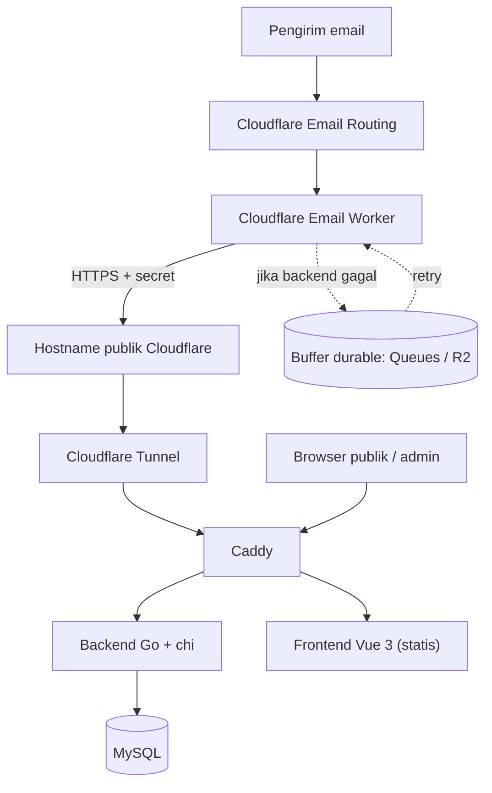

# Product Requirements Document (PRD)

# BaraMail — Admin-Managed OTP Inbox

**Versi:** 1.1
**Tanggal:** 10 November 2026
**Status:** Draft untuk pengembangan (revisi dari v1.0)
**Bahasa:** Indonesia

> Ringkasan perubahan dari v1.0 ada di **Lampiran A**.

---

## 1. Ringkasan Produk

BaraMail adalah aplikasi penerima email berbasis domain milik sendiri yang memungkinkan administrator membuat dan mengelola banyak alamat email. Setiap alamat memiliki inbox terpisah. Pengguna cukup memasukkan alamat email untuk membuka inbox dan membaca email yang diterima, terutama email berisi OTP atau kode verifikasi.

Konsepnya mirip layanan temp-mail, tetapi alamat **tetap aktif** selama tidak dinonaktifkan atau belum kedaluwarsa menurut pengaturan admin.

BaraMail **bukan layanan email penuh** seperti Gmail atau Outlook. Aplikasi ini hanya menerima dan menampilkan email. Tidak ada pengiriman, balasan, penerusan, IMAP, atau POP.

### 1.1 Tujuan utama

1. Administrator dapat membuat banyak alamat email pada satu atau beberapa domain yang dikelola, baik dengan nama custom maupun acak.
2. Setiap alamat mempunyai inbox dan riwayat email sendiri.
3. Pengguna dapat membuka inbox hanya dengan memasukkan alamat email.
4. Email masuk diproses otomatis dan tampil di inbox yang tepat, termasuk email yang hanya berisi HTML.
5. Administrator dapat menonaktifkan alamat atau domain dan mengatur masa aktifnya.
6. Pesan lama dibersihkan otomatis agar data tidak menumpuk.
7. Sistem sederhana, ringan, dan mudah dikembangkan oleh AI coding agent.

### 1.2 Prinsip produk

- **Admin-only provisioning.** Pengguna publik tidak dapat membuat alamat sendiri.
- **Email-only inbox access.** Tidak ada login atau password untuk pengguna inbox.
- **Inbound-only.** Tidak ada fitur mengirim email.
- **Mailbox isolation.** Email untuk satu alamat tidak boleh tampil di inbox lain.
- **Expiration-aware.** Alamat atau domain yang nonaktif/kedaluwarsa tidak dapat diakses dan tidak menerima email baru.
- **Backend sebagai sumber kebenaran.** Cloudflare catch-all menerima semuanya; backend yang menentukan mailbox mana yang sah.
- **Secure-by-default** untuk endpoint admin, webhook, dan konten email.
- **Tidak ada email yang dibuang diam-diam** akibat kegagalan sementara.

### 1.3 Konteks penggunaan dan positioning

Penggunaan utama:

1. **Pemakaian pribadi:** mendaftar ke situs yang kurang dipercaya agar email utama tetap aman.
2. **Kemungkinan dijual sebagai layanan OTP** kepada pelanggan.

Positioning yang wajib dikomunikasikan dengan jelas (di UI, syarat layanan, dan materi penjualan):

- Inbox bersifat **publik bagi siapa pun yang mengetahui alamatnya**.
- Layanan cocok untuk akun sekali pakai dan situs berisiko rendah.
- **Tidak** untuk rekening bank, dompet digital, akun utama, atau layanan penting.

MVP berfokus pada alur yang dikelola admin. Penjualan mandiri (pemesanan, pembayaran) bukan bagian MVP; lihat Bagian 24.

---

## 2. Masalah yang Ingin Diselesaikan

- Pemilik ingin melindungi email utama dari situs yang mencurigakan.
- Mengelola banyak alamat penerima OTP secara manual merepotkan.
- Layanan temp-mail umum tidak stabil: alamat cepat hilang dan domainnya sering diblokir.

BaraMail menyediakan satu panel untuk membuat alamat, memantau masa aktif, dan melihat email masuk pada tiap alamat, dengan domain milik sendiri.

Contoh:

- Admin membuat `budi@domain.tld` (custom) dan `k7x2m9qpa4zt@domain.tld` (acak).
- Sebuah layanan mengirim OTP ke `budi@domain.tld`.
- Pengguna membuka BaraMail, memasukkan `budi@domain.tld`, lalu membaca email OTP.
- Email untuk alamat lain tetap berada di inbox masing-masing.

---

## 3. Target Pengguna dan Hak Akses

### 3.1 Administrator

Administrator adalah satu-satunya pihak yang dapat:

- Login ke dashboard admin.
- Mengelola domain (menambah, menonaktifkan/"retire").
- Membuat mailbox satu per satu (custom/acak) maupun massal.
- Melihat, mengubah status, mengubah masa aktif, dan menghapus mailbox.
- Menjalankan aksi massal (nonaktifkan, aktifkan, perpanjang, hapus).
- Mengekspor daftar mailbox.
- Melihat pesan pada mailbox untuk keperluan pengelolaan.
- Melihat statistik dasar dan audit log.

Password admin disimpan sebagai hash aman, bukan plaintext. MVP memiliki satu peran admin; tabel mendukung lebih dari satu akun admin.

### 3.2 Pengguna publik

Dapat:

- Membuka halaman utama dan memasukkan alamat yang sudah dibuat admin.
- Membuka inbox jika alamat valid, aktif, domainnya aktif, dan belum kedaluwarsa.
- Melihat daftar email dan detail email.
- Memperbarui inbox manual atau lewat polling otomatis.

Tidak dapat:

- Membuat mailbox, mengubah status/masa aktif, atau menghapus mailbox.
- Mengirim, membalas, atau meneruskan email.
- Menelusuri atau mendaftar daftar mailbox.

### 3.3 Konsekuensi model akses publik

**Penting:** karena inbox dibuka hanya dengan memasukkan alamat, siapa pun yang mengetahui alamat dapat membaca seluruh email di inbox itu, termasuk OTP yang masih tersimpan.

Konsekuensi untuk desain:

- **Alamat custom (mis. `budi@domain.tld`) mudah ditebak.** Admin form harus menampilkan label peringatan saat mode custom dipilih.
- **Alamat acak panjang** berfungsi seperti "kunci rahasia" (pola *capability address*) dan lebih aman untuk email sekali pakai, tetapi tetap bukan autentikasi.
- Token inbox hanya mencegah manipulasi request dan membatasi masa sesi. Token tidak membuat inbox privat.
- Sistem wajib menampilkan pemberitahuan yang jelas bahwa inbox bersifat publik bagi siapa pun yang tahu alamatnya.
- Skema database menyiapkan kolom opsional `access_code_hash` (tidak dipakai di MVP) agar tier privat berbayar dapat ditambahkan nanti tanpa migrasi besar.

---

## 4. Ruang Lingkup

### 4.1 Termasuk dalam MVP

- Admin login, dashboard admin, bootstrap akun admin lewat CLI.
- Manajemen domain (multi-domain sejak awal).
- CRUD mailbox dengan dua mode alamat: **custom (default)** dan **acak (opsi)**.
- Bulk create, aksi massal, dan ekspor CSV.
- Pengaturan masa aktif mailbox.
- Penerimaan email inbound via Cloudflare Email Routing dan Email Worker.
- Webhook Worker → backend dengan kontrak raw MIME.
- Parsing MIME di backend, termasuk fallback teks untuk email HTML-only.
- Penyimpanan ke MySQL, deduplikasi, retensi pesan (TTL) dan batas jumlah pesan per mailbox.
- Halaman publik, inbox, detail email, polling inkremental.
- Validasi status/masa berlaku mailbox dan status domain.
- Rate limit, validasi input, logging, audit log admin.
- Tampilan responsif desktop dan mobile.
- Dokumen syarat layanan dan kebijakan penyalahgunaan (abuse) versi awal.

### 4.2 Tidak termasuk dalam MVP

- Mengirim, membalas, atau meneruskan email.
- Login pengguna publik; IMAP/POP3/SMTP server sendiri.
- Pembuatan mailbox mandiri oleh pengguna, pemesanan, dan pembayaran.
- Kode akses per mailbox (kolom disiapkan, fitur belum dibangun).
- Attachment dan download lampiran.
- Render HTML email (MVP hanya plaintext).
- Push notification, WebSocket, aplikasi Android/iOS.
- Integrasi khusus dengan penyedia OTP.
- Multi-tenant dengan banyak organisasi.
- Pencarian kompleks dan analitik lanjutan.
- Sinkronisasi daftar mailbox ke Cloudflare KV untuk penolakan dini di Worker (optimasi pasca-MVP, lihat 13.4).

---

## 5. Alur Pengguna

### 5.1 Alur administrator membuat mailbox

1. Admin membuka `/admin/login` dan login.
2. Admin membuka menu Mailboxes lalu menekan **Create Mailbox**.
3. Admin memilih domain (dari daftar domain aktif).
4. Admin memilih mode:
   - **Custom (default):** mengetik local-part, mis. `budi`. Form menampilkan peringatan bahwa alamat mudah ditebak.
   - **Acak:** memilih panjang (default 12); sistem membuat local-part acak.
5. Admin mengisi masa aktif dan, opsional, `owner_ref` (referensi pelanggan) serta catatan.
6. Sistem memvalidasi format, domain aktif, local-part tidak termasuk daftar reserved, dan keunikan.
7. Sistem menyimpan mailbox dengan status `active` dan menampilkan alamat lengkap serta tanggal kedaluwarsa.

### 5.2 Alur bulk create

1. Admin memilih **Bulk Create**.
2. Admin memilih salah satu mode: (a) tempel daftar alamat custom (satu per baris), (b) prefix + nomor berurutan, atau (c) jumlah alamat acak.
3. Admin memilih domain, masa aktif, `owner_ref`.
4. Sistem memproses dan mengembalikan laporan per item: dibuat, dilewati (duplikat), tidak valid.
5. Admin dapat mengekspor hasil sebagai CSV.

### 5.3 Alur pengguna membuka inbox

1. Pengguna membuka halaman utama dan memasukkan alamat.
2. Frontend mengirim permintaan akses ke backend.
3. Backend menormalisasi alamat, mencari mailbox, dan memeriksa: mailbox ada, status `active`, belum kedaluwarsa, domain berstatus `active`.
4. Jika valid, backend menerbitkan token inbox berumur pendek yang terikat pada satu mailbox.
5. Frontend menampilkan daftar email dan memperbarui secara berkala.

Jika alamat tidak ditemukan, nonaktif, kedaluwarsa, atau domainnya di-retire, backend mengembalikan **respons yang sama** (`MAILBOX_NOT_AVAILABLE`) sehingga tidak membantu enumerasi. Frontend menampilkan pesan generik: "Mailbox tidak tersedia."

### 5.4 Alur email masuk

1. Pengirim mengirim email ke alamat BaraMail.
2. Cloudflare Email Routing menerima email dan catch-all meneruskannya ke Email Worker.
3. Worker membaca **envelope recipient** (`message.to`), envelope sender, dan raw MIME.
4. Worker mengirim raw MIME ke webhook backend melalui HTTPS dengan header autentikasi.
5. Backend memverifikasi autentikasi dan ukuran, lalu mencari mailbox berdasarkan envelope recipient.
6. Backend memastikan mailbox aktif, belum kedaluwarsa, dan domainnya aktif.
7. Backend mem-parse MIME, membuat `dedupe_key`, dan menyimpan dalam satu transaksi.
8. Backend mengembalikan respons sesuai tabel semantik di 10.4 hanya setelah commit.
9. Email muncul di inbox mailbox tersebut pada polling berikutnya.

Jika mailbox tidak tersedia, email tidak disimpan di inbox mana pun dan Worker diberi tahu bahwa penolakan bersifat permanen (tidak di-retry).

---

## 6. Persyaratan Fungsional

### FR-001 — Admin authentication

- Halaman login admin; semua endpoint admin dilindungi autentikasi.
- Password di-hash dengan Argon2id (atau bcrypt dengan cost yang layak).
- Session memakai **cookie HttpOnly, Secure, SameSite** dengan masa berlaku (`ADMIN_SESSION_TTL_HOURS`).
- Endpoint yang mengubah data wajib proteksi CSRF (token CSRF dan validasi header `Origin`).
- Admin dapat logout; session tidak berlaku setelah logout.
- Rate limit dan lockout sementara setelah login gagal berulang.
- Pesan error login tidak membocorkan apakah username terdaftar.
- **Bootstrap:** akun admin pertama dibuat lewat perintah CLI (mis. `baramail admin create`), bukan lewat endpoint publik. Reset password admin juga lewat CLI.
- Rekomendasi hardening opsional: lindungi path `/admin` dan `/api/v1/admin` dengan Cloudflare Access.

### FR-002 — Domain management

- Admin dapat menambah domain, melihat daftar domain, dan mengubah status domain: `active` atau `retired`.
- Domain awal berasal dari `ALLOWED_EMAIL_DOMAINS` (seed saat pertama dijalankan); setelah itu tabel `domains` menjadi sumber kebenaran.
- Mailbox hanya dapat dibuat pada domain `active`.
- Domain `retired`: semua mailbox di domain tersebut tidak dapat diakses dan tidak menerima email baru, tanpa perlu mengubah mailbox satu per satu. Aksi ini harus bisa dilakukan cepat (satu klik) dan dapat dibatalkan.
- Domain tidak dapat dihapus selama masih memiliki mailbox.

### FR-003 — Mailbox creation

- Admin dapat membuat mailbox pada domain aktif dengan dua mode:
  - **Custom (default):** admin mengetik local-part.
  - **Acak:** sistem membuat local-part dengan CSPRNG (`crypto/rand`), karakter `a-z` dan `2-9` tanpa karakter yang mudah tertukar, panjang default `RANDOM_LOCALPART_LENGTH` (12).
- Validasi local-part: 1–64 karakter, hanya `a-z`, `0-9`, `.`, `_`, `-`; tidak diawali/diakhiri titik; tidak ada titik berurutan; `+` tidak diizinkan; panjang alamat total ≤ 254.
- Local-part dalam daftar **reserved** (`RESERVED_LOCALPARTS`, mis. `postmaster`, `abuse`, `admin`, `root`, `noreply`) ditolak.
- Alamat unik setelah dinormalisasi (lowercase, trim). Local-part yang sama pada domain berbeda adalah mailbox berbeda.
- Admin menentukan masa aktif; `expires_at` dihitung dari waktu pembuatan. Batas dari `MAX_MAILBOX_EXPIRY_DAYS`.
- Field opsional: `owner_ref` dan `note`.
- Jika `MAX_MAILBOXES_PER_OWNER` > 0 dan `owner_ref` diisi, pembuatan melebihi batas ditolak.
- Mode custom menampilkan label peringatan bahwa alamat mudah ditebak.
- Status awal: `active`.

### FR-004 — Bulk create dan ekspor

- Mode bulk: (a) daftar alamat custom, (b) prefix + nomor berurutan, (c) jumlah alamat acak.
- Batas per request: `MAX_BULK_CREATE` (default 200).
- Respons berisi laporan per item (dibuat / dilewati karena duplikat / tidak valid beserta alasan). Pada mode acak, tabrakan alamat ditangani dengan membuat ulang.
- Ekspor daftar mailbox ke CSV (alamat, status, kedaluwarsa, owner_ref, catatan). File ekspor tidak berisi isi email.

### FR-005 — Mailbox listing

Dashboard menampilkan: alamat, domain, status (termasuk status turunan *expired*), waktu dibuat, waktu kedaluwarsa, `owner_ref`, jumlah email, dan aksi. Mendukung pencarian alamat, filter status/domain/owner, dan pagination.

### FR-006 — Mailbox update dan aksi massal

Admin dapat:

- Mengubah masa kedaluwarsa dan memperpanjang masa aktif.
- Menonaktifkan dan mengaktifkan kembali mailbox yang belum kedaluwarsa.
- Mengubah `owner_ref` dan catatan.
- Menjalankan **aksi massal** (nonaktifkan, aktifkan, perpanjang, hapus) pada mailbox terpilih atau berdasarkan filter `owner_ref`/domain. Aksi hapus massal wajib konfirmasi.

Mailbox yang sudah lewat `expires_at` tidak boleh dianggap aktif walau status database `active`. Pemeriksaan waktu wajib pada setiap akses inbox, setiap request bertoken, dan setiap penerimaan email.

### FR-007 — Mailbox deletion

- Admin dapat menghapus mailbox setelah konfirmasi.
- Keputusan MVP: penghapusan mailbox menghapus semua pesannya (`ON DELETE CASCADE`).
- Aksi dicatat di audit log.

### FR-008 — Public inbox access

- Pengguna memasukkan alamat; sistem hanya membuka mailbox yang ada, aktif, belum kedaluwarsa, dan berdomain aktif.
- Tidak membutuhkan akun atau password.
- Backend menerbitkan **token inbox** (ditandatangani HMAC dengan `INBOX_TOKEN_SECRET`) yang terikat pada satu mailbox, dengan masa berlaku `INBOX_TOKEN_TTL_MINUTES` (default 30) dan tidak melewati `expires_at` mailbox.
- Setiap request bertoken **memuat ulang mailbox dari database** dan memeriksa status, kedaluwarsa, dan status domain, sehingga penonaktifan berlaku seketika.
- Jangan menerima `mailbox_id` dari client sebagai bukti akses; mailbox ID diambil dari token terverifikasi.
- Token dikirim lewat header `Authorization`, bukan di URL. Frontend menyimpan alamat di memori dan meminta token baru otomatis saat token berakhir.
- Respons gagal seragam untuk semua penyebab (lihat 5.3 dan 12.2).

### FR-009 — Inbox listing

Inbox menampilkan pengirim, subjek, waktu diterima, dan cuplikan isi. Urutan default: terbaru di atas. Pagination berbasis kursor (`before_id`) dan dukungan polling inkremental (`after_id`). Batas `limit` maksimum dikonfigurasi.

### FR-010 — Email detail

Pengguna dapat membuka satu email: pengirim, penerima, subjek, waktu diterima, dan isi.

- **MVP menampilkan plaintext saja.** Isi diambil dari bagian `text/plain`; jika kosong atau tidak bermakna, dari hasil konversi HTML ke teks (lihat FR-013).
- Tampilan plaintext tidak boleh dirender sebagai HTML. URL boleh dijadikan tautan hanya untuk skema `http`/`https` dengan `rel="noopener noreferrer nofollow"`; atau ditampilkan sebagai teks biasa dengan tombol salin.
- Render HTML email adalah fitur pasca-MVP dan wajib memakai sanitasi serta iframe sandbox pada origin terpisah.

### FR-011 — Automatic refresh

- Polling otomatis (default 5 detik) hanya saat halaman inbox aktif, dihentikan saat pengguna meninggalkan halaman.
- Polling memakai `after_id` agar hanya mengambil email baru.
- Saat tab tidak terlihat, interval diperlambat (mis. 30 detik).
- Refresh manual tetap tersedia. Frontend tidak boleh membuat request berlebihan.

### FR-012 — Email ingestion webhook

- Endpoint khusus untuk Worker; hanya menerima request terautentikasi.
- Kontrak: body raw MIME (`Content-Type: message/rfc822`) dengan header metadata (lihat 10.4).
- Backend memvalidasi ukuran, envelope recipient, status mailbox, masa berlaku, dan status domain.
- Backend menyimpan secara atomik, mencegah duplikat, dan mengembalikan sukses hanya setelah commit.
- Respons membedakan kegagalan permanen dan sementara agar Worker tahu kapan harus retry (tabel di 10.4).

### FR-013 — Content processing

- Backend mem-parse MIME dengan library yang terawat (mis. `enmime`; verifikasi sebelum dipakai), mencakup multipart, `text/plain`, `text/html`, charset, header encoding, email tanpa subject, dan email malformed.
- **Fallback HTML-only:** jika bagian `text/plain` tidak ada atau kosong, backend membuat teks dari HTML (strip tag, buang `script`/`style`, rapikan whitespace, decode entity). Konversi **mempertahankan URL** dari tautan, mis. dalam bentuk `teks (https://...)`, karena banyak verifikasi memakai tautan.
- Kolom `body_source` mencatat asal teks: `text`, `html_converted`, atau `empty`.
- **MVP tidak menyimpan `body_html`.** Jika render HTML ditambahkan nanti, kolomnya ditambahkan lewat migration.
- Attachment tidak diproses dan tidak disimpan.
- Email malformed yang tetap dapat dibaca disimpan sebisanya; email yang tidak dapat di-parse sama sekali ditolak dengan kode yang masuk jalur DLQ (10.4), bukan dibuang diam-diam.

### FR-014 — Expiration handling

- Mailbox memiliki `expires_at`; dianggap kedaluwarsa saat waktu sekarang ≥ `expires_at`.
- Mailbox kedaluwarsa tidak dapat dibuka publik dan tidak menerima email baru.
- Dashboard menampilkan status kedaluwarsa (diturunkan dari waktu).

### FR-015 — Retensi pesan dan pembersihan

- **TTL pesan:** pesan dihapus setelah `MESSAGE_RETENTION_HOURS` (default 72 jam) oleh scheduled job.
- **Batas per mailbox:** maksimum `MAX_MESSAGES_PER_MAILBOX` (default 100). Saat melewati batas, pesan **terlama** dihapus dalam transaksi yang sama dengan penyimpanan pesan baru. Email baru tidak ditolak.
- **Mailbox kedaluwarsa:** pesan dihapus setelah `EXPIRED_MAILBOX_RETENTION_DAYS` (default 7 hari) sejak kedaluwarsa; baris mailbox tetap sampai dihapus admin.
- Semua nilai dapat dikonfigurasi. Kebijakan retensi backup mengikuti 17.4.

### FR-016 — Basic statistics

Dashboard dapat menampilkan: total, aktif, nonaktif, dan kedaluwarsa mailbox; total email dan email hari ini; jumlah mailbox per domain; jumlah penolakan webhook per alasan (berguna untuk memantau spam catch-all). Bukan prioritas jika memperlambat MVP.

### FR-017 — Audit log

Aksi admin dicatat: login berhasil/gagal, pembuatan mailbox (termasuk bulk), perubahan masa aktif/status, penghapusan, perubahan domain, ekspor, dan aksi massal. Log tidak berisi password, token, secret, atau isi email.

---

## 7. Persyaratan Nonfungsional

### NFR-001 — Performance

- Target awal (asumsi, disesuaikan setelah ada data nyata): email terlihat di inbox ≤ 10 detik (p95) sejak diterima Cloudflare, dan API inbox p95 ≤ 200 ms pada beban normal.
- Asumsi kapasitas awal: hingga ±1.000 mailbox aktif, ±10.000 email/hari, ±200 tab polling bersamaan.
- Query inbox memakai index; list memakai kursor/limit; response list tidak membawa seluruh isi email.
- Polling inkremental harus ringan (`after_id`, ETag opsional).

### NFR-002 — Reliability

- Email tidak dianggap berhasil sebelum tersimpan.
- Worker menangani kegagalan sementara backend; retry aman dan idempotent.
- Kegagalan akhir tidak boleh membuang email diam-diam (lihat Bagian 13).

### NFR-003 — Security

- HTTPS wajib. Secret di environment variable/secret manager, tidak di frontend atau repository.
- Rate limit pada login, akses inbox, dan endpoint publik, dengan **IP klien yang benar** (lihat 12.7).
- Validasi seluruh input, query dengan parameter binding, CORS terbatas (atau nihil dengan deployment satu origin).
- Proteksi XSS, SQL injection, CSRF (cookie session), dan brute force.
- Jangan mencatat OTP atau isi email ke log. Batasi ukuran payload. Tidak menyimpan attachment.

### NFR-004 — Maintainability

- Pisahkan handler, service, repository, model, konfigurasi.
- Gunakan migration database, `.env.example`, README instalasi/deployment, dokumentasi API, dan test untuk logika penting.

### NFR-005 — Resource efficiency

Target deployment: server kecil. Backend Go dengan `net/http` dan router `chi` serta MySQL dipilih agar penggunaan resource efisien dan dependency minimal.

### NFR-006 — Observability

- Log terstruktur dengan request ID.
- Metrik/penghitung minimal: email diterima, disimpan, duplikat, ditolak per alasan, gagal per kode, latensi ingestion.
- Peringatan (alert) jika tingkat kegagalan webhook tinggi atau antrean DLQ tidak kosong.

---

## 8. Arsitektur Sistem

### 8.1 Komponen

| Komponen | Teknologi | Tanggung jawab |
|---|---|---|
| DNS dan email ingress | Cloudflare DNS + Email Routing | Menerima email domain dan meneruskan ke Worker |
| Email processing | Cloudflare Email Worker | Membaca envelope dan raw MIME, mengirim ke backend, retry |
| Buffer durable (keputusan di Phase 0) | Cloudflare Queues dan/atau R2 | Menampung email saat backend tidak tersedia |
| Akses backend | Cloudflare Tunnel | Mengekspos backend tanpa membuka port inbound |
| Reverse proxy | Caddy (atau Nginx) | Satu origin: sajikan frontend statis dan proxy `/api` ke backend |
| Backend API | **Go + chi (net/http)** | API admin, API inbox, webhook, parsing MIME, business logic |
| Database | **MySQL 8.x** (InnoDB, utf8mb4) | Menyimpan admin, domain, mailbox, email, audit log |
| Frontend | Vue 3 (Vite, TypeScript) | Halaman publik dan dashboard admin |
| Scheduled cleanup | Scheduler di aplikasi atau cron | TTL pesan, batas pesan, pembersihan mailbox kedaluwarsa |

**Alasan Go (bukan Rust):** beban kerja didominasi I/O (CRUD, webhook, query), sehingga keunggulan performa Rust tidak berarti di sini, sementara Go mempercepat pengembangan, memiliki ekosistem email yang matang, deployment satu binary, dan lebih ramah untuk AI coding agent.

**Alasan chi (bukan Fiber):** Fiber dibangun di atas `fasthttp`, tidak kompatibel dengan middleware standar `net/http`, dan buffer request-nya didaur ulang setelah handler selesai (rawan bug saat data dipakai di goroutine). `chi` di atas `net/http` lebih sederhana dan kompatibel dengan ekosistem.

### 8.2 Diagram arsitektur



### 8.3 Catatan infrastruktur

- BaraMail tidak menjalankan SMTP server sendiri; VPS tidak perlu membuka port 25.
- Cloudflare Email Routing mensyaratkan domain memakai Cloudflare DNS (berlaku untuk **setiap** domain mailbox).
- **Tunnel bukan jalur privat dari Worker.** Worker memanggil hostname publik Cloudflare yang kebetulan dilayani Tunnel. Karena itu autentikasi webhook di aplikasi wajib; opsional tambahkan Cloudflare Access service token atau aturan WAF sebagai lapisan kedua.
- Server hanya butuh koneksi outbound ke Cloudflare.
- **Pisahkan domain aplikasi dari domain mailbox.** Contoh: aplikasi di `app.example.com`, mailbox di `domain-a.tld`, `domain-b.tld`. Jika domain mailbox diblokir banyak situs, aplikasi tetap berjalan.
- Satu origin untuk frontend dan API (`/api` lewat Caddy) menghilangkan kebutuhan CORS dan menyederhanakan cookie session.
- Periksa batas penggunaan, ukuran pesan, paket (plan), dan ketentuan layanan Cloudflare (termasuk untuk penggunaan komersial) sebelum produksi. Jangan mengasumsikan tanpa limit.
- Route eksplisit untuk alamat khusus (mis. `abuse@`, `postmaster@` ke email admin yang nyata) harus dikonfigurasi di Email Routing sebelum catch-all; verifikasi urutan prioritas rule di dokumentasi Cloudflare.

### 8.4 Kontrak data email

**Keputusan: Worker mengirim raw MIME apa adanya; backend yang mem-parse.** Alasan: Worker tetap tipis (tanpa risiko batas CPU saat parsing), tidak ada parsing parsial yang membuang isi, dan hash raw MIME memberi kunci deduplikasi yang stabil.

Metadata dikirim lewat header HTTP; body adalah raw MIME. Detail ada di 10.4.

Backend wajib menangani: multipart, `text/plain`, `text/html`, charset, header encoding, email tanpa subject, email malformed, dan batas ukuran.

---

## 9. Rancangan Database (MySQL)

Gunakan MySQL 8.x, engine InnoDB, charset `utf8mb4` dengan collation `utf8mb4_0900_ai_ci`. Simpan waktu dalam UTC secara konsisten (`DATETIME(3)`); DSN driver memakai `parseTime=true&loc=UTC`. Frontend mengonversi ke zona waktu pengguna. Driver yang disarankan: `go-sql-driver/mysql`. Migration dengan tool seperti `goose` atau `golang-migrate` (verifikasi versi saat implementasi).

### 9.1 Tabel `admin_users`

| Kolom | Tipe | Keterangan |
|---|---|---|
| id | BIGINT UNSIGNED | Primary key |
| username | VARCHAR(100) | Unik |
| email | VARCHAR(255) NULL | Opsional |
| password_hash | VARCHAR(255) | Argon2id/bcrypt |
| failed_login_count | INT UNSIGNED | Untuk lockout sementara |
| locked_until | DATETIME(3) NULL | Lockout sementara |
| created_at, updated_at | DATETIME(3) | |

### 9.2 Tabel `domains`

| Kolom | Tipe | Keterangan |
|---|---|---|
| id | BIGINT UNSIGNED | Primary key |
| name | VARCHAR(190) | Unik, lowercase |
| status | ENUM('active','retired') | Default `active` |
| created_at, updated_at | DATETIME(3) | |

### 9.3 Tabel `mailboxes`

| Kolom | Tipe | Keterangan |
|---|---|---|
| id | BIGINT UNSIGNED | Primary key |
| domain_id | BIGINT UNSIGNED | FK ke `domains.id` |
| local_part | VARCHAR(64) | Lowercase |
| email | VARCHAR(255) | Alamat lengkap, unik, ternormalisasi |
| status | ENUM('active','disabled') | Status eksplisit |
| expires_at | DATETIME(3) | UTC |
| owner_ref | VARCHAR(100) NULL | Referensi pelanggan/pemilik (opsional) |
| note | VARCHAR(255) NULL | Catatan admin |
| created_via | ENUM('admin','bulk','self_service') | `self_service` dicadangkan untuk masa depan |
| access_code_hash | VARCHAR(255) NULL | Dicadangkan; tidak dipakai di MVP |
| created_at, updated_at | DATETIME(3) | |

Aturan:

- Simpan alamat lowercase dan trim.
- `email` = `local_part` + `@` + nama domain; keunikan di level database (`UNIQUE`).
- Status kedaluwarsa dihitung dari `expires_at` (tidak ada enum `expired`).
- Domain berstatus `retired` membuat seluruh mailbox-nya tidak tersedia tanpa mengubah baris mailbox.

### 9.4 Tabel `messages`

| Kolom | Tipe | Keterangan |
|---|---|---|
| id | BIGINT UNSIGNED | Primary key, dipakai sebagai kursor |
| mailbox_id | BIGINT UNSIGNED | FK ke `mailboxes.id`, `ON DELETE CASCADE` |
| dedupe_key | BINARY(32) | SHA-256, unik |
| message_id | VARCHAR(998) NULL | Header Message-ID (metadata saja) |
| sender | VARCHAR(320) | Pengirim |
| recipient | VARCHAR(320) | Envelope recipient |
| subject | VARCHAR(998) | Default string kosong |
| body_text | MEDIUMTEXT | Teks (asli atau hasil konversi HTML) |
| body_source | ENUM('text','html_converted','empty') | Asal teks |
| size_bytes | INT UNSIGNED | Ukuran raw MIME |
| received_at | DATETIME(3) | UTC |
| created_at | DATETIME(3) | Waktu disimpan |

**Dedupe key:** `SHA-256(raw MIME bytes || 0x0A || envelope recipient)`. Kunci tidak memakai `received_at` maupun Message-ID agar retry dari Worker menghasilkan kunci yang sama dan email tanpa Message-ID tetap terlindungi. Email yang sama ke dua mailbox berbeda menghasilkan kunci berbeda karena recipient ikut di-hash.

Index dan constraint:

- `UNIQUE (dedupe_key)`.
- `INDEX (mailbox_id, id)` untuk list dan polling inkremental.
- `INDEX (received_at)` untuk pembersihan TTL.
- FK `mailbox_id` dengan `ON DELETE CASCADE`.

Implementasi duplikasi: lakukan `INSERT` biasa dan tangani error duplicate-key (kode 1062) sebagai "duplikat". Jangan memakai `INSERT IGNORE` karena menelan error lain.

### 9.5 Tabel `admin_audit_logs`

| Kolom | Tipe | Keterangan |
|---|---|---|
| id | BIGINT UNSIGNED | Primary key |
| admin_user_id | BIGINT UNSIGNED NULL | Pelaku (NULL untuk login gagal) |
| action | VARCHAR(60) | mis. `mailbox.create`, `domain.retire` |
| target_type, target_id | VARCHAR / BIGINT NULL | Objek yang diubah |
| meta | JSON NULL | Detail non-sensitif |
| ip | VARCHAR(45) | IP klien |
| created_at | DATETIME(3) | |

Jangan menyimpan password, token, secret webhook, atau isi email.

### 9.6 Contoh DDL inti (acuan, dapat disesuaikan)

```sql
CREATE TABLE domains (
  id BIGINT UNSIGNED NOT NULL AUTO_INCREMENT,
  name VARCHAR(190) NOT NULL,
  status ENUM('active','retired') NOT NULL DEFAULT 'active',
  created_at DATETIME(3) NOT NULL,
  updated_at DATETIME(3) NOT NULL,
  PRIMARY KEY (id),
  UNIQUE KEY uq_domains_name (name)
) ENGINE=InnoDB DEFAULT CHARSET=utf8mb4 COLLATE=utf8mb4_0900_ai_ci;

CREATE TABLE mailboxes (
  id BIGINT UNSIGNED NOT NULL AUTO_INCREMENT,
  domain_id BIGINT UNSIGNED NOT NULL,
  local_part VARCHAR(64) NOT NULL,
  email VARCHAR(255) NOT NULL,
  status ENUM('active','disabled') NOT NULL DEFAULT 'active',
  expires_at DATETIME(3) NOT NULL,
  owner_ref VARCHAR(100) NULL,
  note VARCHAR(255) NULL,
  created_via ENUM('admin','bulk','self_service') NOT NULL DEFAULT 'admin',
  access_code_hash VARCHAR(255) NULL,
  created_at DATETIME(3) NOT NULL,
  updated_at DATETIME(3) NOT NULL,
  PRIMARY KEY (id),
  UNIQUE KEY uq_mailboxes_email (email),
  KEY idx_mailboxes_domain (domain_id),
  KEY idx_mailboxes_owner (owner_ref),
  KEY idx_mailboxes_status_expires (status, expires_at),
  CONSTRAINT fk_mailboxes_domain FOREIGN KEY (domain_id) REFERENCES domains (id)
) ENGINE=InnoDB DEFAULT CHARSET=utf8mb4 COLLATE=utf8mb4_0900_ai_ci;

CREATE TABLE messages (
  id BIGINT UNSIGNED NOT NULL AUTO_INCREMENT,
  mailbox_id BIGINT UNSIGNED NOT NULL,
  dedupe_key BINARY(32) NOT NULL,
  message_id VARCHAR(998) NULL,
  sender VARCHAR(320) NOT NULL,
  recipient VARCHAR(320) NOT NULL,
  subject VARCHAR(998) NOT NULL DEFAULT '',
  body_text MEDIUMTEXT NOT NULL,
  body_source ENUM('text','html_converted','empty') NOT NULL,
  size_bytes INT UNSIGNED NOT NULL,
  received_at DATETIME(3) NOT NULL,
  created_at DATETIME(3) NOT NULL,
  PRIMARY KEY (id),
  UNIQUE KEY uq_messages_dedupe (dedupe_key),
  KEY idx_messages_mailbox_id (mailbox_id, id),
  KEY idx_messages_received_at (received_at),
  CONSTRAINT fk_messages_mailbox FOREIGN KEY (mailbox_id)
    REFERENCES mailboxes (id) ON DELETE CASCADE
) ENGINE=InnoDB DEFAULT CHARSET=utf8mb4 COLLATE=utf8mb4_0900_ai_ci;
```

---

## 10. Rancangan API

Prefix `/api/v1`. Semua endpoint dilayani pada origin yang sama dengan frontend (lewat Caddy).

### 10.1 Admin authentication

| Method | Endpoint | Fungsi | Auth |
|---|---|---|---|
| POST | `/api/v1/admin/login` | Login admin | Public, rate-limited |
| POST | `/api/v1/admin/logout` | Logout | Admin |
| GET | `/api/v1/admin/me` | Info session dan token CSRF | Admin |

### 10.2 Admin: domain, mailbox, statistik

| Method | Endpoint | Fungsi |
|---|---|---|
| GET | `/api/v1/admin/domains` | Daftar domain |
| POST | `/api/v1/admin/domains` | Tambah domain |
| PATCH | `/api/v1/admin/domains/:id` | Ubah status (`active`/`retired`) |
| GET | `/api/v1/admin/mailboxes` | Daftar mailbox (search, filter, pagination) |
| POST | `/api/v1/admin/mailboxes` | Buat mailbox (custom/acak) |
| POST | `/api/v1/admin/mailboxes/bulk` | Bulk create |
| POST | `/api/v1/admin/mailboxes/bulk-action` | Aksi massal |
| GET | `/api/v1/admin/mailboxes/export` | Ekspor CSV |
| GET | `/api/v1/admin/mailboxes/:id` | Detail mailbox |
| PATCH | `/api/v1/admin/mailboxes/:id` | Ubah mailbox |
| DELETE | `/api/v1/admin/mailboxes/:id` | Hapus mailbox |
| GET | `/api/v1/admin/mailboxes/:id/messages` | Lihat pesan mailbox |
| GET | `/api/v1/admin/stats` | Statistik dasar |
| GET | `/api/v1/admin/audit-logs` | Audit log |

Semua endpoint admin yang mengubah data memerlukan header CSRF.

Contoh request membuat mailbox custom:

```json
{
  "domain_id": 1,
  "mode": "custom",
  "local_part": "budi",
  "expires_in_days": 7,
  "owner_ref": "cust-0012",
  "note": "paket 1 minggu"
}
```

Contoh request mode acak:

```json
{
  "domain_id": 1,
  "mode": "random",
  "length": 12,
  "expires_in_days": 7
}
```

Contoh response:

```json
{
  "success": true,
  "data": {
    "id": 1,
    "email": "budi@domain.tld",
    "status": "active",
    "expires_at": "2026-11-17T10:00:00Z"
  }
}
```

Contoh request bulk:

```json
{
  "domain_id": 1,
  "mode": "random",
  "count": 50,
  "length": 12,
  "expires_in_days": 30,
  "owner_ref": "cust-0012"
}
```

Mode bulk lain: `"mode": "list"` dengan `"addresses": ["a", "b"]` (local-part), dan `"mode": "sequence"` dengan `"prefix"`, `"start"`, `"count"`.

Contoh aksi massal:

```json
{
  "action": "disable",
  "filter": { "owner_ref": "cust-0012" }
}
```

Backend memvalidasi `expires_in_days` terhadap `MAX_MAILBOX_EXPIRY_DAYS`. Masa aktif tak terbatas tidak diterima kecuali diaktifkan eksplisit di konfigurasi.

### 10.3 Public inbox

| Method | Endpoint | Fungsi | Auth |
|---|---|---|---|
| POST | `/api/v1/inbox/access` | Validasi alamat dan terbitkan token | Public, rate-limited |
| GET | `/api/v1/inbox/messages` | Daftar pesan | Token inbox |
| GET | `/api/v1/inbox/messages/:id` | Detail pesan | Token inbox |

Request akses:

```json
{ "email": "budi@domain.tld" }
```

Response sukses:

```json
{
  "success": true,
  "data": {
    "email": "budi@domain.tld",
    "expires_at": "2026-11-17T10:00:00Z",
    "access_token": "SHORT_LIVED_TOKEN",
    "token_expires_at": "2026-11-10T10:30:00Z"
  }
}
```

Response gagal (seragam untuk tidak ditemukan, nonaktif, kedaluwarsa, domain retired):

```json
{
  "success": false,
  "error": { "code": "MAILBOX_NOT_AVAILABLE", "message": "Mailbox tidak tersedia." }
}
```

Parameter daftar pesan:

- `limit` (default 20, ada batas maksimum).
- `before_id` untuk halaman lebih lama.
- `after_id` untuk polling inkremental (hanya pesan dengan id lebih besar).

Detail pesan hanya mengembalikan pesan milik mailbox pada token; ID pesan dari mailbox lain menghasilkan 404.

### 10.4 Email webhook

`POST /api/v1/webhooks/email`

Header:

| Header | Keterangan |
|---|---|
| `Content-Type` | `message/rfc822` |
| `X-BaraMail-Secret` | Shared secret (≥ 256-bit, acak) |
| `X-BaraMail-Envelope-To` | Envelope recipient (wajib) |
| `X-BaraMail-Envelope-From` | Envelope sender (opsional) |
| `X-BaraMail-Received-At` | Waktu diterima Worker, ISO-8601 UTC (opsional; divalidasi, fallback waktu server) |

Body: raw MIME persis seperti diterima, maksimum `MAX_EMAIL_SIZE_BYTES`.

Autentikasi: perbandingan secret dengan constant-time compare. Mendukung rotasi dengan menerima `WEBHOOK_SECRET` dan `WEBHOOK_SECRET_PREVIOUS`. Karena ingestion idempotent, replay request tidak berbahaya; HMAC bertimestamp bersifat opsional dan dapat ditambahkan nanti.

**Semantik respons dan tindakan Worker:**

| Kondisi | HTTP | Kode error | Tindakan Worker |
|---|---|---|---|
| Tersimpan | 201 | — (`status: "stored"`) | Selesai |
| Duplikat (sudah tersimpan) | 200 | — (`status: "duplicate"`) | Selesai |
| Mailbox tidak ada / nonaktif / kedaluwarsa / domain retired | 404 | `MAILBOX_NOT_AVAILABLE` | Tolak permanen, **tanpa retry**, hitung di metrik |
| Payload terlalu besar | 413 | `PAYLOAD_TOO_LARGE` | Tanpa retry, catat |
| Header/MIME tidak valid dan tidak bisa diproses | 400/422 | `INVALID_MESSAGE` | Kirim ke DLQ/log untuk ditinjau |
| Autentikasi gagal | 401/403 | `UNAUTHORIZED` | Anggap salah konfigurasi: DLQ + alert, bukan retry tanpa batas |
| Rate limit / backend sibuk | 429 | `RATE_LIMITED` | Retry dengan backoff |
| Kegagalan server/database, timeout, error jaringan | 5xx | `INTERNAL_ERROR` | Retry dengan backoff |

Respons sukses (201/200) hanya dikirim setelah commit transaksi.

Contoh respons sukses:

```json
{ "success": true, "data": { "status": "stored" } }
```

### 10.5 Format response API

Sukses:

```json
{ "success": true, "data": {}, "message": "OK" }
```

Error:

```json
{
  "success": false,
  "error": { "code": "MAILBOX_NOT_AVAILABLE", "message": "Mailbox tidak tersedia." }
}
```

HTTP status: `200` sukses, `201` dibuat, `400` input tidak valid, `401` belum terautentikasi, `403` tidak berizin, `404` tidak ditemukan/tidak tersedia, `409` konflik/duplikasi, `413` payload terlalu besar, `422` tidak dapat diproses, `429` rate limit, `500` kesalahan internal.

---

## 11. Frontend dan Halaman

### 11.1 Halaman publik `/`

- Logo/nama BaraMail, input alamat email, tombol Open Inbox, validasi format, pesan error generik.
- **Peringatan jelas:** inbox dapat dibaca siapa pun yang mengetahui alamat; jangan dipakai untuk akun penting.
- Penjelasan singkat bahwa layanan hanya menerima email.
- Tautan ke Syarat Layanan dan kontak penyalahgunaan (abuse).

### 11.2 Halaman inbox `/inbox`

- Alamat aktif, waktu kedaluwarsa, tombol refresh, indikator pembaruan terakhir.
- Daftar email terbaru, tampilan kosong, loading state, error state.
- Detail email (plaintext), tombol salin, tombol kembali.
- Peringatan bahwa inbox bersifat publik.
- Daftar tidak menampilkan seluruh body; detail diambil saat dibuka.
- Polling inkremental dengan `after_id`; interval melambat saat tab tidak terlihat.

### 11.3 Admin login `/admin/login`

Username/email, password, tombol login, loading state, pesan error yang tidak membocorkan keberadaan username.

### 11.4 Admin dashboard `/admin`

- Ringkasan statistik, tabel mailbox dengan kolom `owner_ref` dan catatan.
- Search; filter status, domain, owner; pagination.
- Aksi: lihat, edit, enable/disable, hapus, serta aksi massal.
- Tombol Create Mailbox, Bulk Create, dan Export CSV.
- Indikator masa aktif.

### 11.5 Halaman domain dan audit

- Daftar domain, tambah domain, tombol Retire/Activate dengan konfirmasi.
- Tampilan audit log dengan filter sederhana.

### 11.6 Form mailbox

- Pilihan domain (hanya domain aktif).
- Toggle mode **Custom** (default) dan **Acak**.
- Mode custom: input local-part dengan suffix domain, **label peringatan** bahwa alamat mudah ditebak.
- Mode acak: input panjang dan pratinjau hasil.
- Masa aktif dengan opsi cepat (1, 3, 7, 30 hari) dan custom.
- Field opsional `owner_ref` dan catatan.
- Backend tetap memvalidasi alamat lengkap.

### 11.7 UI/UX

- Responsif, sederhana, cepat; status mailbox jelas.
- Kode verifikasi mudah disalin. Boleh menyorot kode angka 4–8 digit sebagai kemudahan, tetapi **teks email asli selalu ditampilkan**; regex bukan satu-satunya cara menampilkan isi.
- Hindari animasi berat dan dependency UI yang tidak perlu.

---

## 12. Keamanan dan Privasi

### 12.1 Akses inbox

Model email-only berarti alamat berfungsi sebagai kunci akses publik:

- Siapa pun yang mengetahui alamat dapat melihat email, termasuk OTP.
- Menghapus riwayat browser tidak membuat inbox privat.
- Token inbox hanya membatasi manipulasi request dan masa sesi.

Peringatan wajib tampil di halaman utama dan halaman inbox. Alamat acak panjang direkomendasikan untuk pemakaian sensitif-ringan, dan alamat custom diberi label peringatan.

### 12.2 Anti-enumeration

- Rate limit pada endpoint akses inbox.
- Respons **seragam** `MAILBOX_NOT_AVAILABLE` untuk alamat yang tidak ada, nonaktif, kedaluwarsa, atau berdomain retired. Usahakan waktu respons tidak jauh berbeda.
- Tidak ada endpoint publik untuk mendaftar atau menelusuri mailbox.
- Pertimbangkan CAPTCHA atau Cloudflare Turnstile jika terjadi penyalahgunaan.

### 12.3 Webhook authentication

- Shared secret dalam header khusus, minimal 256-bit, dibandingkan dengan constant-time compare.
- Rotasi tanpa downtime lewat `WEBHOOK_SECRET_PREVIOUS`.
- Opsional: Cloudflare Access service token atau aturan WAF sebagai lapisan tambahan.
- Replay tidak berbahaya karena ingestion idempotent; HMAC bertimestamp adalah peningkatan opsional.

### 12.4 Keamanan konten email

- Email adalah input tidak tepercaya.
- MVP menampilkan **plaintext saja**; HTML tidak pernah dirender di origin aplikasi.
- Tautan di teks: hanya skema `http`/`https`, dengan `rel="noopener noreferrer nofollow"`; atau tampilkan sebagai teks.
- Jangan memuat remote resource otomatis. Jangan menyimpan atau mengeksekusi attachment.
- Render HTML (pasca-MVP) wajib sanitasi dengan library terawat, iframe sandbox, CSP ketat, dan origin terpisah.

### 12.5 Retensi data

Sesuai FR-015:

- Pesan dihapus setelah `MESSAGE_RETENTION_HOURS` (default 72 jam).
- Batas `MAX_MESSAGES_PER_MAILBOX` dengan penghapusan pesan terlama.
- Pesan mailbox kedaluwarsa dihapus setelah `EXPIRED_MAILBOX_RETENTION_DAYS`.
- Mailbox dihapus → pesan ikut terhapus.
- Retensi backup dibatasi (lihat 17.4) agar data yang sudah dihapus tidak bertahan lama di backup.

### 12.6 Logging

Log hanya metadata: timestamp, request ID, status proses, kode error, dan mailbox ID bila perlu. Jangan log OTP, raw email body, token, password, atau secret webhook.

### 12.7 IP klien dan rate limiting

- Di belakang Cloudflare, Tunnel, dan Caddy, IP yang dilihat backend adalah IP proxy. Backend harus membaca IP klien dari `CF-Connecting-IP` **hanya** jika request berasal dari proxy tepercaya (`TRUSTED_PROXIES`); jika tidak, semua pengguna berbagi satu bucket rate limit.
- Batas awal (dapat dikonfigurasi): login 5 percobaan/menit/IP dengan lockout sementara; akses inbox 10/menit/IP; list/detail pesan 30/menit/token (kompatibel dengan polling 5 detik, termasuk beberapa tab).
- Endpoint webhook dilindungi secret dan batas ukuran, bukan rate limit per IP.

---

## 13. Reliability, Retry, dan Deduplikasi

OTP sensitif terhadap waktu; email tidak boleh hilang ketika backend sementara tidak tersedia.

### 13.1 Persyaratan

1. Worker mengirim email ke backend melalui HTTPS.
2. Backend hanya mengembalikan sukses setelah transaksi commit.
3. Worker membedakan kegagalan permanen vs sementara sesuai tabel 10.4.
4. Kegagalan sementara di-retry dengan backoff dan batas percobaan.
5. Email yang gagal setelah batas retry masuk ke mekanisme durable (DLQ/penyimpanan) yang dapat ditinjau dan diproses ulang; tidak dibuang diam-diam.
6. Pemrosesan idempotent: retry tidak membuat baris duplikat.
7. Jangan menyimpan email hanya di memori Worker.

### 13.2 Keputusan buffer durable (diputuskan di Phase 0)

Opsi yang dievaluasi, urut preferensi:

1. **Retry inline di Worker** dengan backoff singkat untuk gangguan sesaat, ditambah buffer durable untuk gangguan lebih lama.
2. **Cloudflare Queues** sebagai buffer/retry/DLQ. Perhatikan: batas ukuran pesan Queues kecil (sekitar 128 KB menurut pengetahuan saat PRD ini ditulis; **verifikasi**). Untuk raw MIME yang besar, simpan sementara di **R2** dan antrekan hanya referensinya.
3. Jika kegagalan akhir terjadi dan buffer tidak tersedia: perilaku Cloudflare saat Worker melempar error atau memanggil `setReject` harus diverifikasi (apakah pengirim menerima bounce atau mencoba ulang), didokumentasikan, dan dipilih sebagai fallback terakhir. Tujuannya: pengirim/operator tahu bahwa email gagal, bukan hilang diam-diam.

Hasil verifikasi (ketersediaan Queues/R2 pada plan akun, batas ukuran, perilaku error Worker) dicatat di `docs/CLOUDFLARE_SETUP.md`.

### 13.3 Dedupe

- `dedupe_key = SHA-256(raw MIME || recipient)`.
- Constraint `UNIQUE` di database adalah pertahanan terakhir; pengecekan di aplikasi saja tidak cukup.
- Pesan yang diterima ulang dibalas sukses idempotent (`duplicate`) setelah memastikan data sebelumnya tersimpan.

### 13.4 Spam pada catch-all

Catch-all membuat setiap email ke alamat acak memanggil Worker dan backend, yang bisa menghabiskan kuota Worker atau membebani backend.

- MVP: backend menolak cepat (404) dan menghitung penolakan di metrik; pantau volume dan kuota Cloudflare.
- Pasca-MVP: sinkronkan daftar mailbox aktif ke Cloudflare KV agar Worker menolak dini. Hati-hati: mailbox baru yang belum tersinkron tidak boleh menyebabkan email hilang diam-diam; jalur ini harus fail-open ke backend.

---

## 14. Validasi dan Aturan Bisnis

### 14.1 Normalisasi email

- Trim whitespace dan simpan lowercase.
- Validasi format; domain harus ada di tabel `domains` dan berstatus `active`.
- Jangan menerapkan aturan provider-specific (menghapus titik atau `+tag`). Alamat dengan `+tag` ditolak saat pembuatan; email yang masuk ke `user+tag@` diperlakukan sebagai alamat berbeda dan ditolak jika tidak ada mailbox-nya.

### 14.2 Status mailbox

| Kondisi | Akses publik | Email baru |
|---|---|---|
| `active`, belum kedaluwarsa, domain aktif | Diizinkan | Disimpan |
| `disabled` | Ditolak | Ditolak (404, tanpa retry) |
| `active` tetapi `expires_at` lewat | Ditolak | Ditolak (404, tanpa retry) |
| Domain `retired` | Ditolak | Ditolak (404, tanpa retry) |
| Tidak ditemukan | Ditolak | Ditolak (404, tanpa retry) |

Semua kondisi "Ditolak" pada akses publik memakai respons seragam.

### 14.3 Deduplikasi

Lihat 13.3.

### 14.4 Batas ukuran

Tolak payload melebihi `MAX_EMAIL_SIZE_BYTES` dengan 413. Worker sebaiknya memeriksa `rawSize` lebih dulu. Tidak menerima attachment pada MVP (bagian attachment di-parse sebatas diperlukan lalu diabaikan).

### 14.5 Batas lain

- `MAX_BULK_CREATE` per request bulk.
- `MAX_MAILBOXES_PER_OWNER` (0 = tanpa batas).
- `MAX_MESSAGES_PER_MAILBOX` dan batas `limit` pagination.

---

## 15. Konfigurasi Environment

Contoh `.env.example` backend:

```env
APP_ENV=production
APP_PORT=8080
APP_BASE_URL=https://app.example.com
APP_TIMEZONE=UTC
TRUSTED_PROXIES=127.0.0.1,172.16.0.0/12

DB_HOST=127.0.0.1
DB_PORT=3306
DB_NAME=baramail
DB_USER=baramail_user
DB_PASSWORD=CHANGE_ME
DB_PARAMS=parseTime=true&loc=UTC&charset=utf8mb4

ADMIN_SESSION_SECRET=CHANGE_ME
ADMIN_SESSION_TTL_HOURS=12
INBOX_TOKEN_SECRET=CHANGE_ME
INBOX_TOKEN_TTL_MINUTES=30
WEBHOOK_SECRET=CHANGE_ME
WEBHOOK_SECRET_PREVIOUS=

ALLOWED_EMAIL_DOMAINS=domain-a.tld,domain-b.tld
RESERVED_LOCALPARTS=postmaster,abuse,admin,root,noreply,support
RANDOM_LOCALPART_LENGTH=12
MAX_BULK_CREATE=200
MAX_MAILBOXES_PER_OWNER=0

MAX_EMAIL_SIZE_BYTES=5242880
INBOX_POLL_INTERVAL_SECONDS=5
DEFAULT_MAILBOX_EXPIRY_DAYS=7
MAX_MAILBOX_EXPIRY_DAYS=365

MESSAGE_RETENTION_HOURS=72
MAX_MESSAGES_PER_MAILBOX=100
EXPIRED_MAILBOX_RETENTION_DAYS=7

RATE_LIMIT_LOGIN_PER_MIN=5
RATE_LIMIT_ACCESS_PER_MIN=10
RATE_LIMIT_MESSAGES_PER_MIN=30
```

Catatan:

- Semua nilai hanyalah contoh; secret harus acak dan kuat.
- Jangan commit file `.env` dan jangan menaruh secret di frontend.
- `ALLOWED_EMAIL_DOMAINS` hanya seed awal; setelah itu tabel `domains` menjadi sumber kebenaran.
- Untuk production, gunakan secret management yang sesuai.

Contoh environment Worker:

```env
BARAMAIL_API_URL=https://app.example.com/api/v1/webhooks/email
BARAMAIL_WEBHOOK_SECRET=CHANGE_ME
# Opsional jika memakai Cloudflare Access service token
CF_ACCESS_CLIENT_ID=
CF_ACCESS_CLIENT_SECRET=
```

URL Tunnel tidak menggantikan autentikasi aplikasi; webhook tetap wajib dilindungi secret.

---

## 16. Struktur Project yang Direkomendasikan

Monorepo:

```text
baramail/
├── backend/
│   ├── cmd/
│   │   ├── api/
│   │   │   └── main.go
│   │   └── cli/
│   │       └── main.go            # admin create, reset password, migrasi
│   ├── internal/
│   │   ├── config/
│   │   ├── database/
│   │   ├── middleware/
│   │   ├── handlers/
│   │   ├── services/
│   │   ├── repositories/
│   │   ├── models/
│   │   ├── validators/
│   │   ├── mailparse/             # parsing MIME, konversi HTML ke teks
│   │   └── jobs/                  # TTL, batas pesan, pembersihan
│   ├── migrations/
│   ├── tests/
│   ├── go.mod
│   └── .env.example
├── frontend/
│   ├── src/
│   │   ├── api/
│   │   ├── assets/
│   │   ├── components/
│   │   ├── layouts/
│   │   ├── pages/
│   │   ├── router/
│   │   ├── stores/
│   │   └── types/
│   ├── package.json
│   └── .env.example
├── cloudflare/
│   └── email-worker/
│       ├── src/
│       │   └── index.ts
│       ├── wrangler.toml
│       └── package.json
├── deploy/
│   ├── docker-compose.yml
│   ├── Caddyfile
│   └── README.md
├── docs/
│   ├── API.md
│   ├── ARCHITECTURE.md
│   ├── CLOUDFLARE_SETUP.md
│   ├── TERMS.md
│   └── ABUSE_POLICY.md
├── .gitignore
└── README.md
```

Struktur dapat disesuaikan selama pemisahan concern tetap terjaga.

---

## 17. Deployment dan Infrastruktur

### 17.1 Domain

- Domain aplikasi: `app.example.com` (frontend dan `/api` pada satu origin).
- Domain mailbox: satu atau lebih domain terpisah (mis. `domain-a.tld`), masing-masing memakai Cloudflare DNS dan Email Routing.
- Alamat email memakai domain mailbox, mis. `budi@domain-a.tld`.

### 17.2 Cloudflare Email Routing

1. Pastikan setiap domain mailbox dikelola melalui Cloudflare DNS.
2. Aktifkan Email Routing dan konfigurasi record MX/DNS sesuai instruksi Cloudflare.
3. Buat Email Worker.
4. Konfigurasikan route eksplisit untuk alamat khusus (mis. `abuse@`, `postmaster@`) ke email admin yang nyata.
5. Konfigurasikan catch-all agar sisa email diarahkan ke Worker.
6. Worker membaca envelope recipient dan raw MIME, lalu mengirim ke backend.
7. Uji email ke mailbox aktif, tidak dikenal, disabled, expired, dan domain retired.

Catch-all tidak berarti semua alamat diterima aplikasi; backend tetap menjadi sumber kebenaran.

### 17.3 Backend dan tunnel

1. Jalankan backend pada port internal (mis. 8080) di belakang Caddy.
2. Jalankan MySQL pada jaringan internal; **jangan** mengekspos port database ke internet.
3. Konfigurasikan Cloudflare Tunnel menuju Caddy.
4. Lindungi webhook dengan secret; opsional Cloudflare Access untuk path admin.
5. Pastikan log, monitoring, dan backup berjalan.
6. Atur `TRUSTED_PROXIES` dan pembacaan `CF-Connecting-IP`.

### 17.4 Backup

- Backup MySQL terjadwal (mis. `mysqldump --single-transaction` atau tool backup fisik); uji restore.
- Simpan backup terpisah dari server utama dan lindungi (berisi email dan OTP); enkripsi bila memungkinkan.
- Retensi backup singkat dan selaras dengan kebijakan retensi pesan (mis. maksimum 14 hari) agar data yang sudah dihapus tidak tersimpan lama di backup.

---

## 18. Testing dan Acceptance Criteria

MVP dinyatakan memenuhi kebutuhan jika skenario berikut berhasil.

### 18.1 Admin

- [ ] Admin dapat login dengan kredensial valid; password salah ditolak; lockout aktif setelah percobaan gagal berulang.
- [ ] Akun admin pertama dapat dibuat lewat CLI; tidak ada endpoint publik untuk membuat admin.
- [ ] Endpoint admin tidak dapat diakses tanpa autentikasi; request mengubah data tanpa CSRF ditolak.
- [ ] Cookie session memiliki flag HttpOnly, Secure, dan SameSite.
- [ ] Admin dapat menambah domain dan me-retire/mengaktifkan kembali domain.
- [ ] Admin dapat membuat mailbox mode custom dan mode acak.
- [ ] Alamat acak memakai CSPRNG dan sesuai panjang yang diminta.
- [ ] Sistem menolak alamat tidak valid, domain tidak aktif/tidak dikenal, local-part reserved, dan duplikat.
- [ ] Local-part yang sama pada dua domain berbeda menjadi dua mailbox terpisah.
- [ ] Bulk create (daftar, sekuens, acak) menghasilkan laporan per item dan menghormati `MAX_BULK_CREATE`.
- [ ] Ekspor CSV tidak berisi isi email.
- [ ] Admin dapat menonaktifkan/mengaktifkan mailbox, mengubah/memperpanjang masa aktif, dan menghapus mailbox (pesan ikut terhapus).
- [ ] Aksi massal berdasarkan `owner_ref`/domain bekerja dan tercatat di audit log.
- [ ] `MAX_MAILBOXES_PER_OWNER` ditegakkan bila diatur.
- [ ] Semua aksi admin penting tercatat di audit log tanpa data sensitif.

### 18.2 Public inbox

- [ ] Pengguna dapat membuka mailbox aktif dengan memasukkan alamat.
- [ ] Inbox yang tampil hanya milik alamat tersebut.
- [ ] Alamat tidak dikenal, disabled, expired, dan domain retired menghasilkan respons yang sama.
- [ ] Token inbox tidak dapat digunakan untuk membaca mailbox lain atau pesan mailbox lain.
- [ ] Mailbox yang dinonaktifkan/kedaluwarsa saat token masih berlaku langsung ditolak pada request berikutnya.
- [ ] Pengguna dapat membuka detail email.
- [ ] Polling memakai `after_id`, berjalan sesuai interval, melambat saat tab tersembunyi, dan berhenti saat meninggalkan halaman.
- [ ] Halaman menampilkan peringatan bahwa akses inbox bersifat publik.

### 18.3 Email ingestion

- [ ] Email untuk mailbox aktif tersimpan dan tampil di inbox yang benar saja.
- [ ] Penerima ditentukan dari envelope recipient, bukan header `To:`.
- [ ] Email untuk alamat tidak dikenal, disabled, expired, atau domain retired tidak disimpan dan dibalas 404 tanpa retry.
- [ ] Webhook tanpa/dengan secret salah ditolak; secret lama (`WEBHOOK_SECRET_PREVIOUS`) tetap diterima selama masa rotasi.
- [ ] Payload terlalu besar ditolak (413).
- [ ] Email duplikat (termasuk retry dengan raw MIME yang sama) tidak membuat record duplikat dan dibalas `duplicate`.
- [ ] Email tanpa Message-ID tetap terlindungi dari duplikasi.
- [ ] Email multipart, plaintext, dan tanpa subject dapat diproses.
- [ ] **Email HTML-only menghasilkan teks yang terbaca (`html_converted`) dengan URL tautan tetap terlihat.**
- [ ] Email malformed yang tidak dapat diproses masuk jalur DLQ/log, bukan hilang.
- [ ] Kegagalan database menghasilkan 5xx, bukan sukses palsu; retry setelah kegagalan tidak menggandakan email.
- [ ] Kegagalan sementara di-retry oleh Worker; kegagalan permanen tidak.
- [ ] Melewati `MAX_MESSAGES_PER_MAILBOX` menghapus pesan terlama dan menyimpan pesan baru.
- [ ] Pesan lebih tua dari `MESSAGE_RETENTION_HOURS` dihapus oleh scheduled job.
- [ ] Pesan mailbox kedaluwarsa dihapus setelah `EXPIRED_MAILBOX_RETENTION_DAYS`.

### 18.4 Security

- [ ] Isi email tidak pernah dirender sebagai HTML pada origin aplikasi.
- [ ] Input divalidasi; query aman dari SQL injection.
- [ ] Rate limit aktif pada login, akses inbox, dan list/detail pesan, dan memakai IP klien yang benar (bukan IP proxy).
- [ ] Secret tidak terlihat di frontend atau repository.
- [ ] Log tidak menyimpan OTP, body email, token, atau secret.
- [ ] Database tidak dapat diakses langsung dari internet.

### 18.5 Reliability

- [ ] Backend dapat restart tanpa kehilangan email yang sudah tersimpan.
- [ ] Worker memiliki retry dan buffer durable sesuai keputusan Phase 0.
- [ ] Email yang gagal setelah batas retry dapat ditinjau dan diproses ulang.
- [ ] Pemrosesan idempotent.
- [ ] Backup MySQL dapat direstore.

### 18.6 Bisnis dan kepatuhan

- [ ] Syarat layanan dan kebijakan penyalahgunaan tersedia dan ditautkan dari halaman publik.
- [ ] Alamat `abuse@` aktif dan sampai ke admin.
- [ ] Domain dapat di-retire cepat tanpa mengubah mailbox satu per satu.

---

## 19. Prioritas Pengembangan

### Phase 0 — Spike integrasi Cloudflare (de-risk)

1. Setup satu domain uji, Email Routing, dan catch-all ke Email Worker.
2. Worker mengirim raw MIME + header ke endpoint backend sederhana yang menyimpan satu baris ke MySQL.
3. Verifikasi: ketersediaan Queues/R2 pada plan, batas ukuran, dan perilaku Cloudflare saat Worker error/`setReject`.
4. Verifikasi bahwa Worker dapat menjangkau backend lewat hostname Tunnel dan pembacaan `CF-Connecting-IP`.
5. Uji parsing dengan sampel email nyata: multipart, HTML-only, charset non-UTF-8, tanpa subject.
6. Catat hasil di `docs/CLOUDFLARE_SETUP.md` dan putuskan strategi buffer (13.2).

**Definition of Done:** satu email nyata dari luar masuk lewat Cloudflare dan tersimpan di MySQL; keputusan buffer dan retry terdokumentasi.

### Phase 1 — Fondasi backend

1. Inisialisasi Go + chi, konfigurasi environment, koneksi MySQL, migration.
2. Model dan repository (admin, domains, mailboxes, messages, audit).
3. Admin authentication (cookie session, CSRF, lockout) dan CLI bootstrap admin.
4. CRUD domain dan mailbox (custom/acak), bulk create, aksi massal, ekspor.
5. Unit test untuk validasi alamat, normalisasi, dan masa kedaluwarsa.

**Definition of Done:** admin dapat login dan mengelola domain serta mailbox melalui API.

### Phase 2 — Public inbox

1. Endpoint akses inbox dan token inbox (cek ulang mailbox per request).
2. Endpoint daftar (kursor, `after_id`) dan detail pesan.
3. Rate limit dengan IP klien yang benar.
4. Respons seragam anti-enumeration.
5. Test isolasi mailbox.

**Definition of Done:** pengguna dapat membuka inbox hanya dengan alamat dan tidak dapat berpindah ke mailbox lain lewat manipulasi request.

### Phase 3 — Email ingestion

1. Finalisasi kontrak webhook (10.4) dan autentikasi (termasuk rotasi secret).
2. Parser MIME dan fallback HTML-only ke teks (URL dipertahankan).
3. Dedupe key dan penyimpanan transaksional dengan batas pesan per mailbox.
4. Validasi status mailbox, masa berlaku, dan domain.
5. Retry, buffer durable, dan DLQ di Worker sesuai Phase 0.
6. Scheduled job: TTL pesan dan pembersihan mailbox kedaluwarsa.
7. Test end-to-end.

**Definition of Done:** email dari Cloudflare masuk ke mailbox yang tepat dan tidak hilang diam-diam saat backend gagal.

### Phase 4 — Frontend

1. Halaman publik dan inbox dengan peringatan publik.
2. Detail email plaintext dan polling inkremental.
3. Admin login, dashboard, form mailbox (custom/acak), bulk create, domain, audit log.
4. Responsive layout.

**Definition of Done:** alur admin dan pengguna dapat digunakan melalui browser.

### Phase 5 — Production hardening dan kesiapan bisnis

1. Cloudflare DNS dan Email Routing untuk semua domain mailbox.
2. Worker, Tunnel, Caddy, dan HTTPS produksi.
3. Security headers, monitoring, alert, dan metrik ingestion.
4. Backup, restore test, dan kebijakan retensi backup.
5. Uji beban ringan.
6. Syarat layanan, kebijakan abuse, dan alamat `abuse@`.
7. Dokumentasi deployment.

**Definition of Done:** aplikasi berjalan stabil pada domain produksi dengan proses pemulihan dan penanganan penyalahgunaan yang jelas.

---

## 20. Panduan untuk AI Coding Agent

Dokumen ini adalah sumber requirement utama selama pengembangan.

### 20.1 Cara bekerja

1. Baca seluruh PRD sebelum membuat perubahan.
2. Periksa struktur repository sebelum mengubah file.
3. Buat implementation plan per phase dan kerjakan satu phase pada satu waktu.
4. Jangan mengerjakan seluruh sistem dalam satu perubahan besar.
5. Setelah setiap phase, jalankan formatter, linter, build, dan test yang relevan.
6. Perbarui dokumentasi ketika kontrak API atau konfigurasi berubah.
7. Laporkan file yang dibuat/diubah, perintah test, hasil test, dan pekerjaan yang belum selesai.

### 20.2 Dependency dan dokumentasi

- Gunakan versi stabil terbaru yang kompatibel; periksa dokumentasi resmi sebelum memilih API atau dependency.
- Jangan mengarang nama package, method, atau konfigurasi; verifikasi library (mis. parser MIME, driver MySQL, tool migration) sebelum dipakai.
- Hindari dependency yang tidak diperlukan; catat versi pada lockfile/manifest.
- Jangan memakai API deprecated bila ada alternatif yang direkomendasikan.

### 20.3 Aturan implementasi

- Jangan mengubah requirement inti tanpa alasan dan persetujuan.
- Jangan menambahkan fitur email outbound, registrasi mailbox publik, atau login pengguna inbox sebagai syarat akses MVP.
- Jangan menganggap alamat email sebagai data rahasia.
- Jangan pernah mengirim secret ke frontend atau menyimpan password plaintext.
- Jangan memakai Fiber/fasthttp; gunakan `net/http` dengan `chi`.
- Jangan menganggap Worker selalu berhasil mengirim data ke backend, dan jangan membuat fallback yang diam-diam membuang email.
- Jangan mengembalikan HTTP sukses sebelum transaksi database commit.
- Jangan memakai `received_at` atau Message-ID saja sebagai dasar dedupe.
- Jangan membedakan respons publik antara mailbox tidak ada, nonaktif, kedaluwarsa, atau domain retired.
- Jangan mengandalkan validasi frontend saja.
- Jangan merender HTML email di MVP; tampilkan plaintext.
- Jangan menggunakan IP proxy untuk rate limit.
- Gunakan migration untuk setiap perubahan skema database.

### 20.4 Urutan kerja yang disarankan

Mulai dari **Phase 0** (spike Cloudflare), lalu Phase 1 dan seterusnya. Jangan membuat frontend sebelum kontrak API dan model data inti stabil, kecuali wireframe/prototype.

Sebelum melanjutkan ke phase berikutnya, agent harus: menjalankan test, memastikan build berhasil, memeriksa error/warning, memperbarui dokumentasi, memberi ringkasan hasil, dan menyebutkan risiko atau keputusan yang masih butuh persetujuan.

### 20.5 Keputusan

**Sudah diputuskan di PRD ini:** Go + chi, MySQL 8.x, raw MIME ke backend, plaintext saja di MVP, fallback HTML ke teks, hapus pesan saat mailbox dihapus (`CASCADE`), cookie session HttpOnly untuk admin, satu origin via Caddy, multi-domain sejak awal, TTL pesan 72 jam, batas 100 pesan per mailbox, retensi mailbox kedaluwarsa 7 hari.

**Harus ditanyakan/dicatat sebelum implementasi (jangan diasumsikan):**

- Nama domain aplikasi dan domain mailbox produksi.
- Nilai final retensi dan batas jika berbeda dari default.
- Strategi buffer durable (hasil Phase 0).
- Rencana penjualan: kapan alur pemesanan/pembayaran dan kode akses per mailbox dibangun.

Untuk MVP, gunakan pilihan paling sederhana dan aman yang sesuai PRD, lalu dokumentasikan asumsi.

---

## 21. Risiko dan Mitigasi

| Risiko | Dampak | Mitigasi |
|---|---|---|
| Alamat mailbox diketahui/ditebak orang lain | OTP dapat dibaca pihak lain | Peringatan publik, opsi alamat acak, label peringatan di mode custom, jangan untuk akun penting, kode akses pasca-MVP |
| Domain mailbox diblokir banyak situs | OTP tidak sampai ke pelanggan | Multi-domain, retire cepat, pisahkan domain aplikasi, pantau blocklist |
| Penyalahgunaan layanan (pendaftaran massal, penipuan) | Domain/akun Cloudflare bermasalah | Syarat layanan, kebijakan abuse, batas per owner, nonaktifkan cepat/massal, audit log |
| Pelanggaran ketentuan atau batas Cloudflare | Layanan email terhenti | Baca ToS dan limit, pantau kuota, siapkan rencana cadangan |
| Spam ke catch-all | Kuota Worker habis, beban backend | Penolakan cepat, metrik, optimasi KV pasca-MVP |
| Backend tidak tersedia | Email gagal masuk | Retry, buffer durable, DLQ, monitoring, idempotency |
| Batas ukuran Queues untuk email besar | Email besar tak dapat diantrekan | R2 sebagai penyimpanan sementara, verifikasi di Phase 0 |
| Email duplikat | Inbox berisi pesan ganda | Dedupe key stabil dan unique constraint |
| Email HTML-only tampil kosong | OTP tidak terbaca | Fallback HTML ke teks dengan URL dipertahankan |
| HTML email berbahaya | XSS atau tracking | Plaintext saja di MVP; sanitasi dan isolasi bila HTML ditambahkan |
| Penyalahgunaan endpoint publik / enumerasi | Beban server, mailbox terdeteksi | Rate limit dengan IP benar, respons seragam, Turnstile bila perlu |
| Mailbox expired tetap menerima email | Data masuk ke mailbox tidak aktif | Validasi expiration pada webhook dan pada tiap akses |
| Secret bocor | Webhook dapat dipalsukan | Secret manager/env, rotasi dua-secret, Cloudflare Access opsional |
| Database atau backup bocor | Isi email dan OTP terekspos | Akses terbatas, enkripsi, retensi pendek (pesan dan backup) |
| Aspek hukum/regulasi belum ditinjau | Risiko kepatuhan saat berjualan | Konsultasi hukum sebelum komersial (Bagian 24) |

---

## 22. Definisi Selesai (MVP)

MVP BaraMail selesai ketika:

1. Admin dapat login, dan akun admin pertama dibuat lewat CLI.
2. Admin dapat mengelola domain (tambah, retire, aktifkan kembali).
3. Admin dapat membuat mailbox mode custom maupun acak, secara tunggal maupun massal, serta melihat, mengubah, menonaktifkan, mengaktifkan, dan menghapus mailbox.
4. Setiap mailbox memiliki masa aktif; aksi massal dan ekspor CSV tersedia.
5. Pengguna dapat membuka inbox hanya dengan memasukkan alamat, tanpa login.
6. Pengguna hanya dapat melihat email untuk mailbox yang sedang diakses.
7. Email yang masuk melalui Cloudflare Email Routing dan Worker tersimpan di mailbox yang tepat, termasuk email HTML-only.
8. Inbox diperbarui otomatis secara inkremental.
9. Mailbox disabled/expired atau domain retired tidak dapat diakses dan tidak menerima email baru, dengan respons publik yang seragam.
10. Webhook aman, idempotent, membedakan kegagalan permanen/sementara, dan memiliki strategi retry yang durable.
11. Pesan dibersihkan otomatis sesuai TTL dan batas per mailbox.
12. Konten email ditampilkan dengan aman (plaintext).
13. Rate limit memakai IP klien yang benar.
14. Syarat layanan, kebijakan abuse, dan `abuse@` tersedia.
15. Dokumentasi instalasi, konfigurasi, API, dan deployment tersedia.
16. Acceptance criteria utama di Bagian 18 lulus.

---

## 23. Ringkasan Keputusan Produk

| Area | Keputusan MVP |
|---|---|
| Nama aplikasi | BaraMail |
| Jenis layanan | Inbound-only OTP inbox |
| Domain | Satu atau lebih domain milik administrator, dikelola lewat tabel `domains` |
| Pembuatan mailbox | Administrator saja; mode custom (default) dan acak (opsi); bulk create |
| Jumlah mailbox | Banyak |
| Pemisahan inbox | Per alamat email |
| Akses pengguna | Memasukkan alamat email, tanpa login |
| Privasi inbox | Publik bagi siapa pun yang mengetahui alamat |
| Masa aktif | Diatur admin; domain dapat di-retire |
| Email outbound | Tidak tersedia |
| Email ingress | Cloudflare Email Routing + Email Worker |
| Kontrak webhook | Raw MIME + header metadata (envelope recipient) |
| Backend | Go + chi (`net/http`) |
| Database | MySQL 8.x (InnoDB, utf8mb4) |
| Frontend | Vue 3 |
| Reverse proxy | Caddy, satu origin untuk frontend dan `/api` |
| Tunnel | Cloudflare Tunnel (bukan jalur privat; webhook wajib dilindungi secret) |
| Refresh inbox | Polling inkremental (`after_id`), default 5 detik |
| Format tampilan email | Plaintext; fallback konversi HTML-only ke teks |
| Attachment | Tidak didukung di MVP |
| Retensi pesan | TTL 72 jam, maks 100 pesan/mailbox, mailbox kedaluwarsa 7 hari |
| Retry | Wajib, durable (strategi final diputuskan di Phase 0) |
| Deduplikasi | Wajib; `SHA-256(raw MIME + recipient)` dengan unique constraint |
| Anti-enumeration | Respons publik seragam `MAILBOX_NOT_AVAILABLE` |
| Admin session | Cookie HttpOnly + CSRF; bootstrap lewat CLI |
| Penjualan | Manual/dikelola admin di MVP; self-service dan kode akses pasca-MVP |
| Deployment | Server/VPS kecil yang menjalankan backend dan MySQL |

**Arah implementasi:** mulai dari spike integrasi Cloudflare (Phase 0), lanjut backend dan database, lalu akses inbox publik, integrasi Worker penuh, frontend, dan terakhir hardening produksi.

---

## 24. Aspek Bisnis, Kepatuhan, dan Penyalahgunaan

Bagian ini bersifat panduan; **bukan nasihat hukum**. Konsultasikan dengan ahli hukum sebelum berjualan secara resmi.

### 24.1 Tahap pengembangan bisnis

1. **Tahap A, pemakaian pribadi.** Gunakan MVP sendiri; alamat acak direkomendasikan untuk situs berisiko.
2. **Tahap B, penjualan manual.** Admin membuat mailbox per pelanggan (memakai `owner_ref`), pembayaran dan pengiriman alamat dilakukan di luar aplikasi. Validasi permintaan pasar di tahap ini.
3. **Tahap C, self-service.** Pemesanan, pembayaran, dan pengiriman alamat otomatis; kolom `created_via = self_service` dan `access_code_hash` sudah disiapkan. Pertimbangkan tier privat berbayar dengan kode akses per mailbox.

### 24.2 Strategi domain

- Gunakan lebih dari satu domain mailbox sejak awal.
- Pisahkan domain aplikasi dari domain mailbox.
- Siapkan prosedur mengganti/me-retire domain yang terblokir dan memantau reputasinya.

### 24.3 Penyalahgunaan (abuse)

- Syarat layanan melarang penggunaan untuk penipuan, pelanggaran hukum, dan pendaftaran massal yang melanggar ketentuan situs lain.
- Sediakan kontak abuse (`abuse@`) dan prosedur penanganan laporan dengan target waktu respons.
- Admin harus dapat menonaktifkan mailbox, pelanggan (via `owner_ref`), atau domain dengan cepat.
- Terapkan batas jumlah mailbox per pelanggan (`MAX_MAILBOXES_PER_OWNER`) dan simpan audit log.

### 24.4 Kepatuhan

- Periksa ketentuan layanan Cloudflare (Email Routing/Workers) untuk penggunaan komersial, volume, dan batas paket.
- Tinjau kewajiban pendaftaran penyelenggara sistem elektronik (PSE) dan ketentuan perlindungan data pribadi di Indonesia, karena layanan menyimpan email milik pihak ketiga.
- Dokumentasikan kebijakan retensi (pesan dan backup) dan komunikasikan di Syarat Layanan.
- Komunikasikan dengan jelas bahwa inbox bersifat publik bagi yang mengetahui alamat.

---

## Lampiran A — Ringkasan Perubahan dari v1.0

| # | Perubahan |
|---|---|
| 1 | Database **MariaDB → MySQL 8.x**: DDL, tipe data (`DATETIME(3)`, `BINARY(32)`, `MEDIUMTEXT`), DSN, penanganan duplicate-key, backup. |
| 2 | Backend **Go + Fiber → Go + chi (`net/http`)**, dengan alasan; Go dipilih dibanding Rust. |
| 3 | Mode alamat: **custom (default) dan acak (opsi)**, plus label peringatan, validasi local-part, reserved local-parts, **bulk create**, ekspor CSV, aksi massal. |
| 4 | **Multi-domain** sejak awal (tabel `domains`, status `retired`, domain aplikasi dipisah dari domain mailbox). |
| 5 | Konteks bisnis: positioning, tahap penjualan, strategi domain, abuse, kepatuhan (Bagian 24, 1.3). Kolom `owner_ref`, `note`, `created_via`, `access_code_hash`. |
| 6 | **Fallback HTML-only → teks** (URL dipertahankan); `body_html` tidak disimpan di MVP. |
| 7 | **Respons publik seragam** untuk menyelesaikan kontradiksi antara 5.2 dan 12.2 pada v1.0. |
| 8 | **Kontrak ingestion**: raw MIME, envelope recipient, `dedupe_key = SHA-256(raw MIME + recipient)` (tidak memakai `received_at`), tabel semantik respons permanen vs sementara. |
| 9 | Autentikasi webhook disederhanakan (shared secret + rotasi dua-secret); HMAC menjadi opsional karena ingestion idempotent. |
| 10 | Klarifikasi arsitektur Tunnel (bukan jalur privat), Caddy satu origin, `TRUSTED_PROXIES` dan IP klien untuk rate limit. |
| 11 | **Retensi pesan**: TTL, batas pesan per mailbox, pembersihan mailbox kedaluwarsa, retensi backup. |
| 12 | Strategi buffer durable dengan catatan batas ukuran Queues/R2 dan keharusan verifikasi di Phase 0; mitigasi spam catch-all. |
| 13 | Polling inkremental (`after_id`), paginasi kursor, token inbox dengan pengecekan ulang status mailbox per request. |
| 14 | Admin: bootstrap via CLI, lockout, cookie session + CSRF, audit log masuk MVP. |
| 15 | NFR terukur (target awal dan asumsi kapasitas) dan NFR observabilitas. |
| 16 | **Phase 0** (spike integrasi Cloudflare) ditambahkan di depan roadmap. |
| 17 | Keputusan terbuka di 20.5 diselesaikan dengan default; sisanya didaftar eksplisit. |
| 18 | Acceptance criteria, risiko, dan definisi selesai diperbarui sesuai perubahan di atas. |
