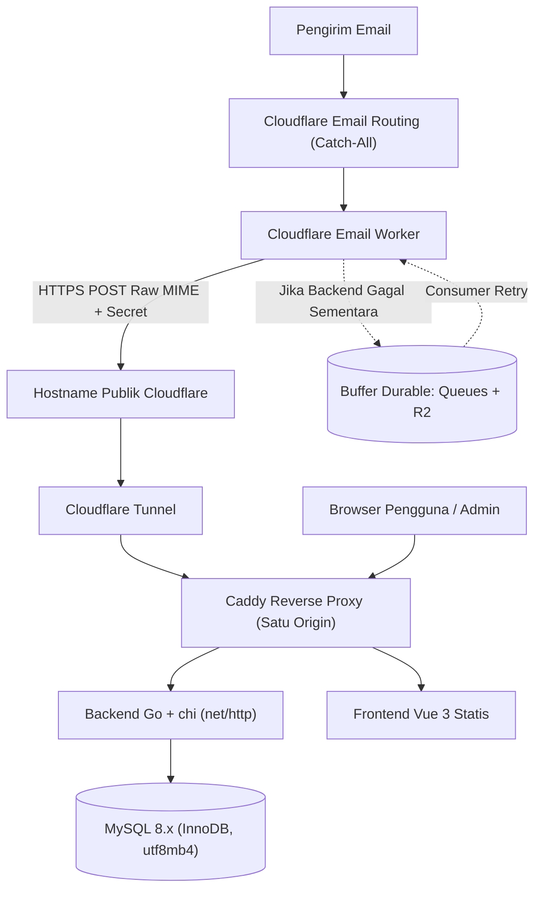

# Arsitektur Sistem BaraMail

## 1. Alur Komponen

## 2. Keputusan Desain Utama

1. **Pemisahan Domain Aplikasi & Domain Mailbox:**
   Aplikasi web berjalan pada domain tersendiri (mis. `app.example.com`), sedangkan penerimaan email berjalan pada satu atau beberapa domain mailbox (`domain-a.tld`, `domain-b.tld`). Apabila sebuah domain mailbox diblokir oleh situs pihak ketiga, domain tersebut dapat di-*retire* dalam satu klik tanpa mengganggu domain aplikasi maupun domain mailbox lain.
2. **Kontrak Raw MIME (`message/rfc822`):**
   Cloudflare Email Worker meneruskan raw MIME tanpa mem-parse di Worker. Backend Go melakukan parsing MIME, decoding charset, konversi fallback HTML-only ke plaintext (dengan mempertahankan URL tautan verifikasi), serta penghitungan kunci deduplikasi `SHA-256(raw MIME || 0x0A || envelope recipient)`.
3. **Isolasi & Pengecekan Ulang per Request:**
   Token inbox ditandatangani dengan HMAC-SHA256 dan terikat pada satu `mailbox_id`. Pada setiap request daftar maupun detail pesan, backend memuat ulang baris mailbox beserta status domain dari MySQL untuk memastikan penonaktifan, kedaluwarsa, atau *retire* domain berlaku seketika.
4. **Penyimpanan Transaksional & Retensi:**
   Penyimpanan email baru dan pemangkasan pesan terlama yang melebihi `MAX_MESSAGES_PER_MAILBOX` (default 100) dijalankan dalam satu transaksi database. Pembersihan berdasarkan umur pesan (`MESSAGE_RETENTION_HOURS`, default 72 jam) dan mailbox kedaluwarsa (`EXPIRED_MAILBOX_RETENTION_DAYS`, default 7 hari) dijalankan secara berkala oleh `CleanupRunner`.

